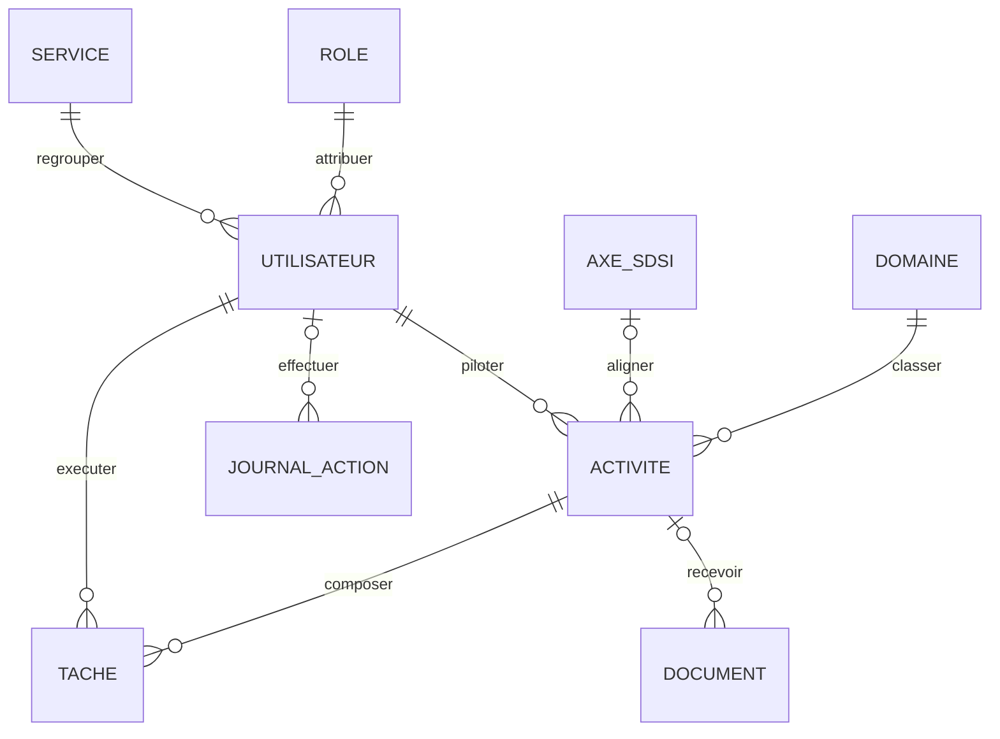

# Conception de l’application de suivi des activités de la DSID

## 1. Objectif et périmètre

Application web interne en français permettant de planifier les activités de la DSID, d’en suivre les responsables, tâches, échéances et documents, puis de produire des indicateurs et un historique fiable.

Socle cible : Laravel 13, PHP 8.3, PostgreSQL, Blade, Bootstrap 5 et JavaScript. L’application est monolithique MVC ; une API mobile et les notifications sont hors du périmètre initial.

## 2. Acteurs et responsabilités

| Rôle | Capacités principales |
|---|---|
| Administrateur | Gérer les comptes, rôles, services, domaines et axes SDSI ; consulter les journaux. |
| Directeur | Consulter toutes les activités, tableaux de bord et rapports ; valider selon le circuit retenu. |
| Chef de service | Créer et suivre les activités de son service ; affecter des tâches ; consulter le périmètre de son service. |
| Agent | Consulter les activités auxquelles il contribue ; mettre à jour ses tâches ; déposer des documents selon autorisation. |
| Lecteur | Consulter les informations et rapports auxquels son périmètre lui donne accès, sans modification. |

Les rôles sont des données de référence créées par seed. Les contrôles d’accès sont imposés côté serveur par policies/middleware ; masquer un bouton dans l’interface ne constitue pas une autorisation.

## 3. MCD (MERISE)



`JOURNAL_ACTION` est une entité technique complémentaire nécessaire à la règle RG14 ; elle conserve l’auteur même après désactivation d’un compte (auteur nullable si suppression exceptionnelle). Les documents peuvent être déposés avant rattachement ou être associés à une activité ; l’interface normale les rattachera à l’activité.

## 4. MLD / MPD cible

- `roles` : `id`, `name` unique (`administrateur`, `directeur`, `chef_service`, `agent`, `lecteur`), `label`.
- `services` : `id`, `name` unique, `description` nullable, `is_active`, timestamps.
- `users` : colonnes Laravel d’authentification, `first_name`, `last_name`, `role_id` obligatoire, `service_id` obligatoire, `is_active`, `last_login_at` nullable. Email unique ; mot de passe haché par Laravel.
- `domaines` : `id`, `name` unique, `description` nullable, `is_active`, timestamps.
- `axes_sdsi` : `id`, `title`, `description` nullable, `is_active`, timestamps.
- `activites` : `id`, `title`, `description` nullable, `type` (`projet` / `activite_courante`), `start_date`, `due_date` nullable, `status` (`a_demarrer`, `en_cours`, `en_attente`, `termine`, `annule`), `progress` smallint 0–100, `priority` (`faible`, `moyenne`, `haute`), `domaine_id`, `responsable_id`, `axe_sdsi_id` nullable, timestamps, `deleted_at`.
- `taches` : `id`, `title`, `description` nullable, `due_date` nullable, `status` mêmes valeurs qu’une activité, `progress` smallint 0–100, `activite_id`, `agent_id`, `created_by` nullable, timestamps, `deleted_at`.
- `documents` : `id`, `original_name`, `storage_path`, `mime_type`, `size_bytes`, `uploaded_by` nullable, `activite_id` nullable, timestamps. Le fichier est stocké sur le disque privé Laravel ; la base ne contient que ses métadonnées et son chemin.
- `journal_actions` : `id`, `user_id` nullable, `action`, `subject_type`, `subject_id` nullable, `before` JSONB nullable, `after` JSONB nullable, `ip_address` nullable, `created_at`. Table append-only, non supprimée en cascade avec l’utilisateur ou l’objet.

Clés étrangères indexées. Suppression physique interdite pour les utilisateurs et données métier utilisées dans l’audit ; désactivation ou suppression logique privilégiée. Suppression d’une activité : bloquée tant que des tâches/documents subsistent, ou archivage logique de l’ensemble selon la politique retenue. Les valeurs de statut/type/priorité sont validées à la fois dans Laravel et par contraintes SQL lorsque possible.

Domaines initiaux à charger comme référentiel : gestion informatique et documentaire ; planification des systèmes d’information ; suivi du SDSI ; projets de digitalisation ; sécurité des systèmes d’information.

## 5. Règles de gestion et arbitrages retenus

1. Un utilisateur possède un rôle et appartient à un service ; un rôle/service peut concerner plusieurs utilisateurs.
2. Toute activité possède exactement un domaine et un responsable ; l’axe SDSI est facultatif.
3. Une tâche appartient à une activité et est affectée à un agent. Pour autoriser le brouillon, une activité peut temporairement n’avoir aucune tâche ; avant passage à « en cours » ou « terminé », elle doit en comporter au moins une. Cela rend réalisable une création progressive malgré la cardinalité minimale 1 du cahier.
4. Une activité de type « projet » exige une échéance ; une activité courante peut ne pas en avoir. La date de début ne peut être postérieure à l’échéance.
5. Une tâche peut ne pas avoir d’échéance. Si elle en a une, l’échéance est comparée à la date du jour.
6. Une activité/tâche est en retard si son échéance est passée et son statut n’est ni `termine` ni `annule`. Le retard est calculé, pas stocké, afin d’éviter une donnée périmée.
7. Pour un statut `termine`, l’avancement vaut 100 ; pour `a_demarrer`, il vaut 0. Les autres statuts acceptent 0–99 (règle ajustable après validation métier).
8. L’avancement d’une activité est calculé automatiquement comme la moyenne des avancements de ses tâches actives (arrondie à l’entier le plus proche) ; sans tâche, il vaut 0. Une activité ne peut être clôturée que si toutes ses tâches sont terminées.
9. Chaque création, modification, changement d’état, archivage et ajout/suppression de document écrit une entrée d’audit avec acteur, date/heure et différence avant/après. Les secrets (mot de passe, jetons) ne sont jamais journalisés.
10. Les comptes inactifs ne peuvent pas s’authentifier. Les référentiels utilisés par des enregistrements existants sont désactivés, pas supprimés.

## 6. Matrice d’autorisations initiale

| Fonction | Admin | Directeur | Chef de service | Agent | Lecteur |
|---|---:|---:|---:|---:|---:|
| Gérer utilisateurs et référentiels | Oui | Non | Non | Non | Non |
| Voir toutes les activités / indicateurs | Oui | Oui | Non | Non | Selon périmètre |
| Voir activités de son service | Oui | Oui | Oui | Si affecté | Selon service |
| Créer/modifier activité | Oui | Validation/lecture | Dans son service | Non | Non |
| Gérer tâches | Oui | Lecture | Dans son service | Ses tâches (avancement) | Non |
| Déposer document | Oui | Selon droit | Dans son service | Activités auxquelles il contribue | Non |
| Consulter journal d’audit | Oui | Lecture globale | Non | Non | Non |

La portée exacte de « lecteur » et le pouvoir de validation du directeur sont des paramètres métier à confirmer avant de figer les policies.

## 7. Parcours et écrans

1. **Connexion** : email/mot de passe, compte actif, limitation des tentatives et déconnexion.
2. **Tableau de bord** : compteurs par statut/domaine, progression, échéances proches et retards ; agrégation limitée au périmètre autorisé.
3. **Liste des activités** : recherche texte, filtres domaine/statut/responsable/période/priorité, tri et pagination serveur ; badge retard calculé.
4. **Création/édition** : titre, type, description, dates, domaine, axe facultatif, responsable, priorité ; validations explicites et messages en français.
5. **Fiche activité** : synthèse, tâches, documents téléchargeables via contrôleur autorisé, historique des événements métier.
6. **Tâches** : affectation, statut, échéance et progression ; l’agent ne peut modifier que les champs autorisés de ses tâches.
7. **Administration** : comptes, services, rôles de référence, domaines et axes SDSI.
8. **Journal d’audit** : réservé à l’administrateur, filtrable par acteur, action, période et type d’objet.
9. **Rapports** : vue imprimable et export des activités filtrées ; export PDF/Excel planifié après stabilisation des données et du tableau de bord.

## 8. Architecture Laravel proposée

```text
app/
  Enums/                 StatutActivite, TypeActivite, Priorite, Role
  Http/Controllers/      Dashboard, Activite, Tache, Document, Admin, Audit
  Http/Requests/         Validation dédiée par action
  Models/                User, Role, Service, Domaine, AxeSdsi, Activite, Tache, Document, JournalAction
  Policies/              ActivitePolicy, TachePolicy, DocumentPolicy, referentiels
  Services/              AuditService, DashboardService, UploadDocumentService
  Rules/                  Règles métier (progression, cohérence dates)
database/
  migrations/ seeders/ factories/
resources/views/         layouts/, auth/, dashboard/, activites/, taches/, admin/
routes/web.php
```

Les contrôleurs orchestrent requêtes et réponses ; les `FormRequest` valident et autorisent ; les policies définissent le périmètre ; les transactions regroupent écriture métier et audit. Les documents sont téléchargés au moyen d’une route authentifiée, jamais par URL publique directe.

## 9. Sécurité, ergonomie et exploitation

- Sessions sécurisées, CSRF Laravel, validation côté serveur, échappement Blade, limitation des tentatives de connexion.
- Téléversement privé : liste blanche de formats utiles (PDF, DOCX, XLSX, images autorisées), taille maximale configurable, nom de stockage généré, nom original conservé comme métadonnée, vérification de l’autorisation à chaque téléchargement.
- Pas de suppression/modification du journal depuis l’interface ; accès et données personnelles minimisés.
- Interface responsive Bootstrap, français/UTF-8, navigation clavier, états vides et erreurs compréhensibles.
- Sauvegarde PostgreSQL et documents avec procédure de restauration documentée ; la sauvegarde ne doit pas être confondue avec le seul redémarrage des conteneurs.
- Docker doit fournir PHP-FPM, Nginx et PostgreSQL. Le montage actuel pointe vers `./dsid`, absent à ce stade ; la configuration Nginx attend `dsid/public`. La conception du code doit être suivie de l’initialisation effective du projet Laravel avant de démarrer cette pile.

## 10. Ordre de réalisation proposé

1. Initialiser le projet Laravel et sa configuration PostgreSQL/Docker.
2. Créer migrations, enums/référentiels, factories et seeders des cinq rôles et domaines initiaux.
3. Mettre en place authentification, comptes actifs, policies et périmètre par service.
4. Réaliser CRUD activités/tâches, validations métier et journal d’audit transactionnel.
5. Ajouter dépôt privé de documents, tableau de bord, filtres et journal consultable.
6. Ajouter exports, sauvegarde automatisée et documentation d’exploitation.

Les choix ouverts du tableau d’autorisations et la cardinalité « service/utilisateurs » doivent être validés avec le métier avant la mise en production ; les hypothèses ci-dessus permettent néanmoins de démarrer le modèle et d’être corrigées par migrations avant déploiement.
